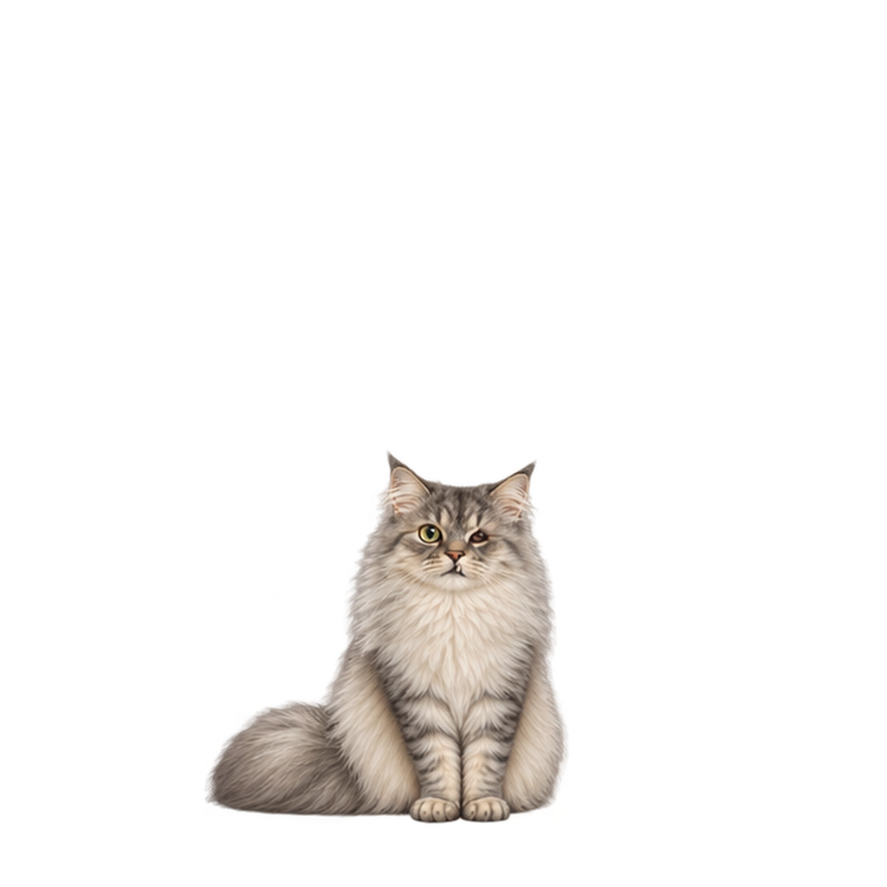

# Odin desktop companion

A portable Windows desktop cat companion.

<p align="center">
  
</p>

## Download and run

Open [the latest release](https://github.com/BurtFablehoff/Odin/releases/latest).

- **Odin-Setup-3.1.2.exe** installs Odin for your Windows user, adds a Start menu shortcut, offers a desktop shortcut, and provides an uninstall entry.
- **Odin.exe** is the portable version. Save it in a writable folder and double-click it.

The finished artwork is embedded in either download. No source files or separate artwork are needed to run Odin. Windows 10 or later, x64-compatible, is required for the installer.

Right-click Odin or his system tray icon for settings, size, monitor controls, updates and Quit. The menu and tray tooltip show the current version. Small is the default size. Odin remains above normal windows without taking keyboard focus.

## Version 3.1.2

Odin chooses his own behavior. The main menu does not contain commands to make him pose or perform actions. The four resting states are Sitting, Loaf, Laying down awake, and Sleeping. Each holds its body pose while eligible expressions occur independently.

| Feature | Frames |
| --- | ---: |
| Sitting gaze | 19 |
| Loaf gaze | 12 |
| Awake laying gaze | 14 |
| Eye expressions for each awake resting state | 3 |
| Running left | 18 |
| Running right | 16 |
| Jumping left | 16 |
| Jumping right | 16 |

Loaf uses a smaller consistent scale. Running has separate size corrections and tail-aware monitor margins. Running in-betweens preserve the original poses and cycle duration. Horizontal torso registration stabilizes both running directions, including the loop seam. Awake laying adds 11:20 and 11:40 gaze poses. The jumping sequences include the reviewed frame-order corrections.

Window perches can start only from Sitting or awake Laying. Subtle occasional tail flicks are available while Sitting, awake Laying, or Sleeping; the broken loaf tail flick is excluded. Walking and belly-up content are excluded from this release.

Start with Windows defaults on after the first main-version launch. Turn it off in the right-click menu. Development builds do not register themselves for Windows startup.

## Updates and settings

Main-channel settings are stored in the current user's local application data under `OdinCompanionV3`. Automatic updates check this repository's GitHub Releases and verify download size, SHA-256, product identity and version before installation. Backups, startup health checks and rollback are supported. Disable Automatic updates in the menu to update manually.

To update manually, quit Odin and replace the portable EXE, or run the newer installer. Separate development copies use their own settings and do not update themselves.

## Source and artwork

For continued work on this PC, use this checkout directly. Run `./odin.ps1` for
local build, review, verification, and packaging commands. Portable image and
installer tools live inside `local-data/toolchain`; see
[local development](tools/local/LOCAL-DEVELOPMENT.md). No OneDrive export or
transfer copy is needed. The new resting artwork review is separate from the
released runtime and still follows the approval decisions in the local handoff.

The C# source, installer recipe, app icon and all finished sprite images needed by this release are included. Original reference photos and videos are excluded. `art/frames/` contains the finished transparent sprite PNGs and `art/manifest.json` describes the animation pack.

On 64-bit Windows with Windows PowerShell and the .NET Framework C# compiler, open PowerShell in this folder and run:

```powershell
powershell -NoProfile -ExecutionPolicy Bypass -File .\build.ps1
```

This packs the included PNGs and builds a runnable `build/Odin.exe`, with no separate artwork download or third-party runtime packages. To check source compilation without artwork, use `./build.ps1 -CompileOnly`. To supply an existing pack, use `./build.ps1 -AssetPack <path-to-Odin.assets>`.

With Inno Setup 7.1.1 installed, run `ISCC.exe installer/Odin.iss` after building. This produces `build/Odin-Setup-3.1.2.exe`.

Development menu code is conditional on `ODIN_DEV`; the main build does not define it. Production and development builds have separate identities and settings.

## Checks and desktop behavior

The application supports `--self-test <report.json>`, `--test-updater <report.json>`, `--menu-test <report.json>`, and `--smoke-test <report.json>`. Rendering tests need a Windows desktop session.

Odin uses cursor position, mouse-button state, Escape-key state and visible-window geometry for interaction. There are no telemetry uploads. Network access is used for GitHub release checks and downloads.

## Local multi-pet development

This repository can also live inside the local `pet/Odin` workspace alongside
other independent pet repositories and a shared framework. It still builds on its
own. `app/SharedSleepBreathing.cs` is the framework snapshot;
`planning/shared-framework.json` records its provenance. Odin artwork, settings,
release identity, and behavior selection remain specific to this repository.
